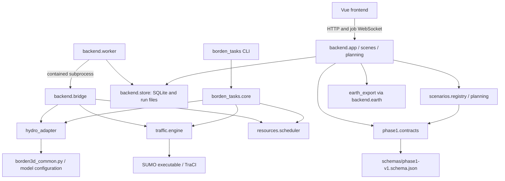

# Architecture

The source checkout contains a command-line task runner and a browser application.
Both use the existing groundwater, traffic and resource implementations.

## Responsibilities and dependencies

| Location | Responsibility |
|---|---|
| `borden_tasks/__main__.py` | Argument parsing and JSON CLI responses |
| `borden_tasks/core.py` | Four task evaluators, engine calls and create-only task outputs |
| `phase1/contracts.py` | Common `Problem`, frozen-schema validation, hashing, JSON and safe paths |
| `phase1/backend/core.py` | Backend run-status/model-build envelopes and compatible contract re-exports |
| `phase1/backend/app.py` | HTTP/WebSocket routes and request validation |
| `phase1/backend/scenes.py`, `planning.py`, `custom_tasks.py` | Versioned scene loading and dispatch configuration |
| `phase1/backend/store.py` | SQLite snapshots, jobs, transitions and events |
| `phase1/backend/worker.py`, `processes.py`, `bridge.py` | Durable execution, recovery and contained engine processes |
| `phase1/hydro_adapter/` | Solver validation, scientific build identity and engine adaptation |
| `phase1/traffic/` | Actual SUMO routing, closures and optional dynamic traffic |
| `phase1/resources/` | Existing resource feasibility/scheduling decoder |
| `phase1/scenarios/` | Catalog, SHA-bound scene assets and planning metadata |
| `phase1/earth_export/` | KML/KMZ export; geographic-transform checks apply |
| `phase1/frontend/` | Vue views, Cartesian map layers, replay, API access and event stream |

Scene catalog reads use `phase1.contracts` directly, without importing the backend
application or creating its SQLite store. Existing backend imports of these helpers
continue to work. Runtime planning verification still calls the backend custom-task
validator when a bound custom task is present. Local imports between scene/planning
installers assemble routes after definitions are available; there is no eager
application-import cycle in the catalog read path.

The CLI JSON writer is create-only, while the backend's writer atomically replaces
mutable runtime metadata. They intentionally retain separate write semantics.
The CLI task-result envelope and the backend engine envelopes also serve distinct
interfaces; the latter remain governed by the frozen Phase I schema.

## Execution and data

The CLI selects a scene, checks its referenced files and invokes an existing engine.
It writes `input.json`, `result.json` and `artifact-index.json` in a new output
directory. Scientific runs use the original solver and parameter checks.

The API records immutable scene/parameter snapshots and queued jobs. A separate
worker claims jobs, checks admission and scene bindings, runs engines and validates
published artifacts before marking success. Recovery and cancellation retain their
existing process and state-transition rules. The store is SQLite plus files;
there is no external message broker.

The Borden reference and synthetic scene have separate IDs, manifests, source
records and coordinate frames. The 100 km service frame and the local groundwater
grid are configured independently. `MODEL_SHA256.json` identifies the original
scientific implementation and configuration; scene manifests bind their own assets.

## Frontend boundaries

`App.vue` selects `MapWorkspace` or explicit run/fixture `ReplayView`. The workspace
handles selection and user commands; `PlanningPanel` handles configuration;
`DeckMap` owns deck.gl layers, camera and renderer resources. `mapReplay.js` prepares
validated replay state, `mapClock.js` controls time, and `mapGeometry.js` computes
view geometry. `apiReplay.js` loads SHA-bound API artifacts. `sceneClient.js` provides
request cancellation/generation checks. `mapStatusStream.js` supplies job status
events, while vehicle/concentration replay comes from validated artifacts.

`canonical.js` provides the shared JSON snapshot comparison used by API replay,
custom-task verification and map replay. It sorts object keys and preserves array
order. It does not replace the original serialized bytes or recorded SHA256 values.
Renderers retain their existing layout, coordinate transforms and lifecycle cleanup.
